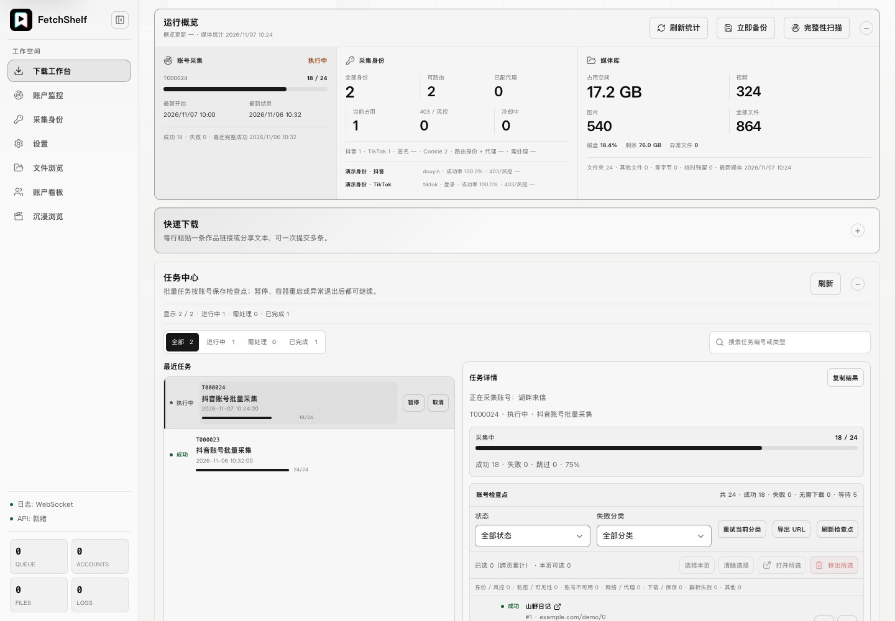
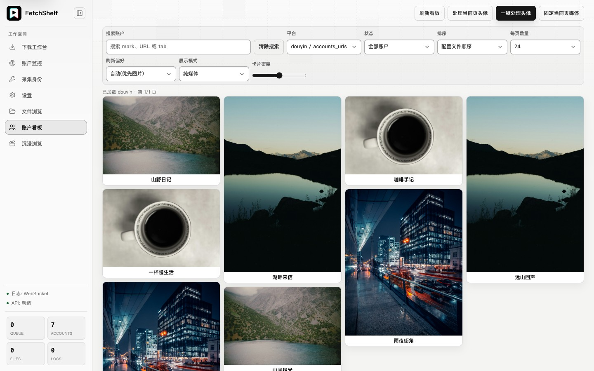
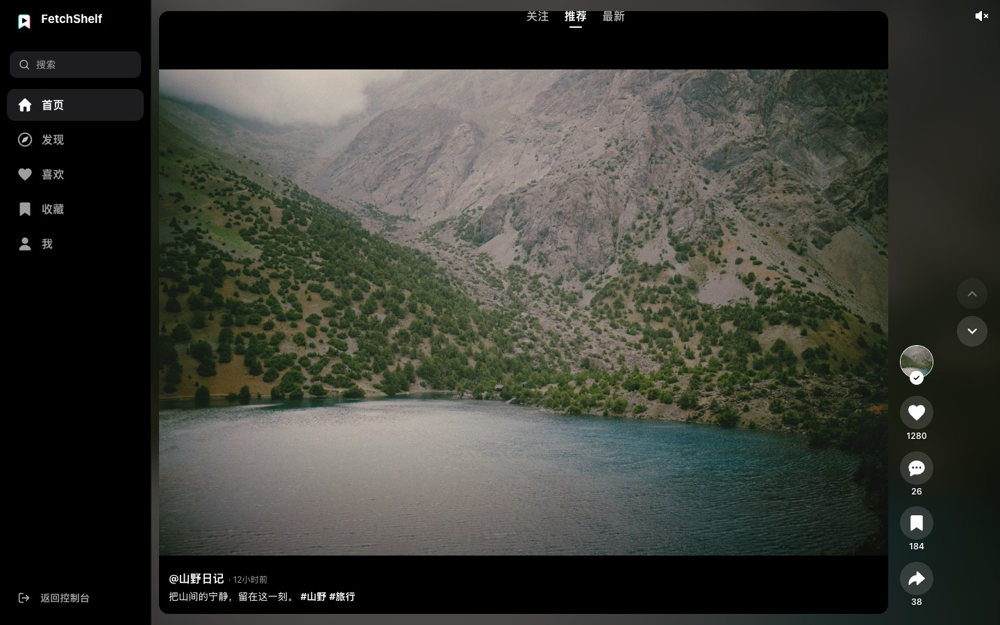
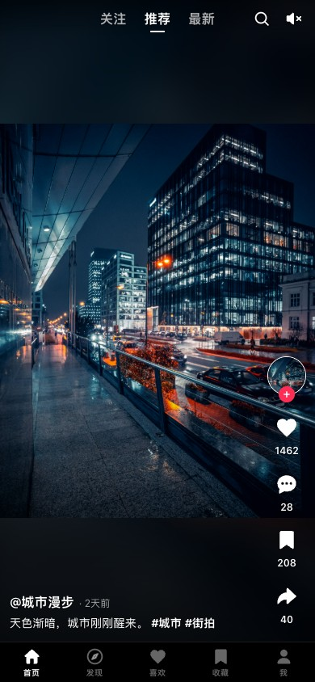
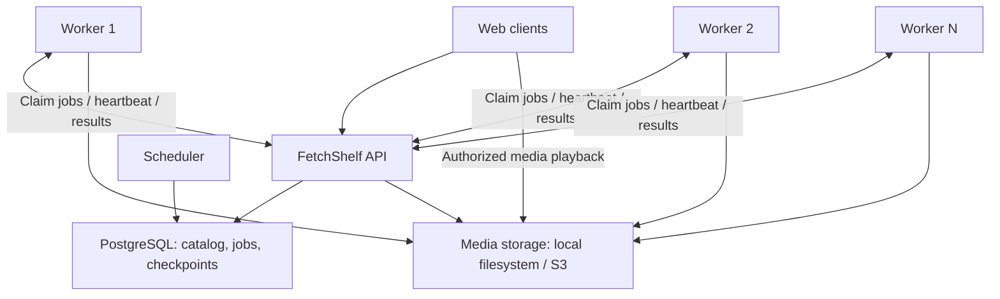

# FetchShelf

Docker-first Douyin / TikTok collection, download, and media management.

> [!IMPORTANT]
> Deploy with **Docker Compose** and manage collection and media through the
> **WebUI** or **Web API**.

## What it provides

- Douyin and TikTok account collection
- Multi-account batch and daily scheduled tasks
- Task progress, history, pause, resume, and stop controls
- Searchable and sortable account dashboard
- Paginated masonry media browser with image and video lightbox previews
- Immersive full-screen feed of downloaded posts (`/ui/feed`), with profiles, likes, saves and follows that stay on your own server
- Settings, Cookie, collector identity, proxy, and routing management
- FastAPI documentation and endpoints

## WebUI preview

Captured from the actual WebUI with fictional demo accounts, tasks, and statistics
and licensed sample photos. No private account or login data is shown.
[Capture notes and photo credits](docs/screenshot/webui/README.md).

**Download workbench** — Library statistics, collector identities, and batch task progress in one place.



**Account board** — Browse account covers with search, filters, and a media-only view.



**Immersive browsing** — Browse downloaded posts on desktop and mobile, with like, save, and share controls.





## Planned distributed architecture

This is the target architecture, **not an implemented feature**. The current
version schedules jobs within a single process, stores runtime state in SQLite,
and manages media through the local filesystem. Remote workers and S3 storage
are not supported yet.



| Component | Responsibility |
| --- | --- |
| API | Client authentication, catalog queries, worker coordination, and media access authorization |
| Scheduler | Create durable jobs from collection schedules |
| Worker | Claim jobs, report heartbeats, collect content, download media, and generate previews |
| PostgreSQL | Store the catalog, job leases, pagination checkpoints, and identity state |
| Storage interface | Provide common access to local filesystems and S3, independently or together |

Roles can share a host or scale independently; workers connect outbound to the
API. Identities retain stable network-route assignments and share rate limits
and cooldowns. Verification pauses the affected identity while retaining progress.

Media has stable IDs, and job retries do not create duplicate records. Files enter
the library only after verification and registration as ready; worker scratch
space is not permanent storage. Remote workers use authenticated uploads for
filesystem storage or upload directly to S3. The API authorizes media access,
using temporary signed URLs for S3. Folder scanning becomes an import and
reconciliation tool rather than the source for everyday browsing.

## Deployment and access

| Interface | Purpose |
| --- | --- |
| Docker Compose | Build from source and deploy without requiring prebuilt images |
| WebUI | Browser interface at `/ui` |
| Web API | Programmatic access, with documentation at `/docs` |

## Quick start

Requirements:

- Git
- Docker Engine or Docker Desktop
- Docker Compose v2

Clone the current repository:

```bash
git clone https://github.com/silencoo/FetchShelf.git
cd FetchShelf
cp .env.example .env
```

Generate two different random values:

```bash
python -c "import secrets; print(secrets.token_urlsafe(32))"
python -c "import base64,secrets; print(base64.urlsafe_b64encode(secrets.token_bytes(32)).decode())"
```

Add them to `.env`:

```dotenv
TZ=Asia/Shanghai
WEBUI_PORT=5555
SETTINGS_DIR=./settings
DOWNLOADS_DIR=./downloads
FETCHSHELF_API_TOKEN=replace-with-the-first-value
FETCHSHELF_IDENTITY_KEY=replace-with-the-second-value
```

Build and start:

```bash
docker compose up -d --build
docker compose ps
```

Open `http://HOST_IP:5555/ui` and enter `FETCHSHELF_API_TOKEN`. In
Settings, set the download root to `/app/downloads`.

## Persistent data

| Host setting | Container path | Contents |
| --- | --- | --- |
| `SETTINGS_DIR` | `/app/settings` | Settings, databases, task state, cache, and account avatars |
| `DOWNLOADS_DIR` | `/app/downloads` | Downloaded images, videos, and exported data |
| `.env` | Environment variables | WebUI token, identity key, and mount paths |

Back up the two directories, `.env`, and especially
`FETCHSHELF_IDENTITY_KEY`. Changing or losing the identity key makes existing
encrypted Cookies, proxies, and device information unreadable. A Docker Secret
can be supplied through `FETCHSHELF_IDENTITY_KEY_FILE`; a key file takes
precedence over the environment variable.

Do not commit `.env`, Tokens, Cookies, or identity keys.

## Common operations

```bash
docker compose logs --tail=100
docker compose logs -f
docker compose stop
docker compose restart
docker compose up -d --build
```

## Updating and migrating

For stable paths, recorded image revisions, and bounded rollback backups on
TrueNAS, see [TrueNAS deployment](deploy/truenas/README.md).
The TikTok-Api dependency is included in this repository; no submodule setup is required.

Before an update, stop active collection writes and back up `.env`,
`SETTINGS_DIR`, and `DOWNLOADS_DIR`.

```bash
git pull
docker compose build --pull
docker compose up -d
docker compose ps
docker compose logs --tail=100
```

When replacing an older container:

1. Record its environment variables and mounts.
2. Stop active collection and wait for current writes to finish.
3. Back up or snapshot the settings and downloads directories.
4. Point the new Compose configuration at the same persistent directories.
5. Stop the old container before starting FetchShelf.
6. Verify accounts, schedules, task history, media files, and latest-work times.

Never run two containers against the same writable settings and downloads
directories.

For upgrades from the pre-rename release:

- Move the old WebUI token and identity key values to
  `FETCHSHELF_API_TOKEN` and `FETCHSHELF_IDENTITY_KEY`; old variable names are
  not accepted.
- Keep the identity key value unchanged.
- The Compose service and container are both named `fetchshelf`.
- On first startup, the old application database is copied once to
  `FetchShelf.db`; the source database is not modified or deleted.

## Security notes

- Public-account collection often works without a Cookie.
- A logged-in Cookie can improve visibility for some content, but can also
  increase rate-limit or account-control risk.
- An empty `FETCHSHELF_API_TOKEN` only permits loopback requests; Docker and LAN
  requests normally receive `403`.
- Do not expose the WebUI directly to the public Internet. Use HTTPS, a reverse
  proxy, and additional access control when remote access is required.
- Only load a trusted external `encipher.py`; it runs with application
  permissions.

## API and development

After startup:

- WebUI: `http://HOST_IP:5555/ui`
- Swagger: `http://HOST_IP:5555/docs`
- ReDoc: `http://HOST_IP:5555/redoc`

Frontend development instructions are in
[webui/README.md](./webui/README.md). The Chinese
[README](./README.md) is the primary deployment guide.

## License and acknowledgement

This project is provided for lawful, authorized learning and research use.
Users are responsible for complying with local law, platform rules, privacy
requirements, and intellectual-property rights.

Distributed under the
[GNU General Public License v3.0](./license).

FetchShelf evolved from
[TikTokDownloader](https://github.com/JoeanAmier/TikTokDownloader). Thanks to
the original author and all open-source contributors.
